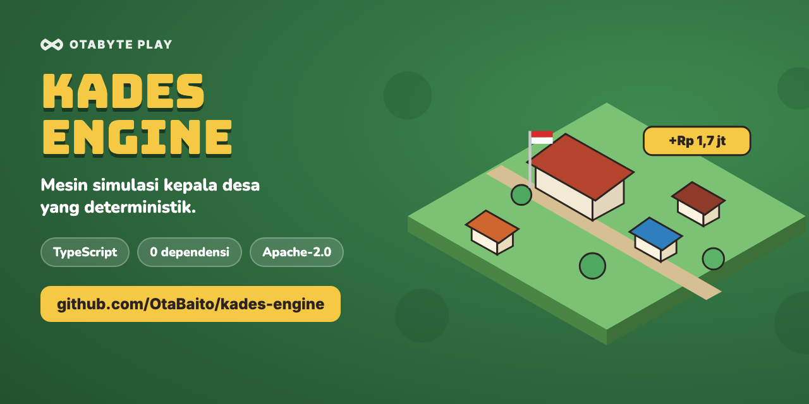
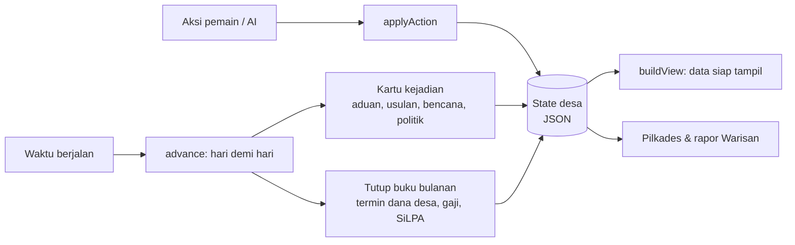

<p align="center">
  
</p>

<p align="center">
  <a href="LICENSE"></a>
  
  
  
  
  <a href="https://play.otabyte.net/aws/"></a>
</p>

<h3 align="center">Jadi kepala desa, dalam kode.</h3>

<p align="center">
  Mesin simulasi di balik <a href="https://play.otabyte.net/aws/"><b>Asal Warga Senang</b></a>, game browser simulasi kepala desa buatan <a href="https://otabyte.net">OtaByte</a>.<br />
  Dana desa, warga, pembangunan, BUMDes, auditor, sampai pilkades. Semua deterministik, semua bisa dites.
</p>

<p align="center"><i>A deterministic, dependency-free TypeScript engine that simulates running an Indonesian village. <a href="#english">English summary below.</a></i></p>

---

## Sekilas

Kamu baru menang pilkades. Desa tertinggal menunggumu, dan pilkades berikutnya tinggal 12 bulan lagi.

```ts
import { createVillage, advance, applyAction, buildView } from './src/index.ts';

let desa = createVillage({ seed: 'sukamaju-1', namaDesa: 'Sukamaju', namaKades: 'Budi', tipe: 'agraris' });

desa = advance(desa, 30).state;                    // satu bulan berlalu
const r = applyAction(desa, { type: 'tagih' });    // tagih iuran warga

console.log(r.events.map((e) => e.teks));
// [ 'Retribusi masuk kas: Rp 31,3 jt.', 'Pencapaian baru: Uang Masuk.' ]

console.log(buildView(r.state).kasTeks);
// Rp 596,3 jt
```

Jalankan seed yang sama dua kali, hasilnya identik sampai ke rupiah terakhir.

## Kenapa Kades Engine

| | |
| --- | --- |
| **Deterministik** | Semua keacakan lewat RNG ber-seed di dalam state. Seed + urutan aksi yang sama = hasil yang sama. Cocok untuk replay, liga, dan tes regresi. |
| **Fungsi murni** | `createVillage`, `advance`, `applyAction`, `buildView`. Tidak ada I/O, tidak ada jam sistem. State berupa JSON biasa yang bisa disimpan di database mana pun. |
| **Tanpa dependensi** | TypeScript murni. Jalan langsung di Node 22.18+ (type stripping), atau dibundel ke browser dengan Vite/esbuild. |
| **Server-authoritative** | Dirancang supaya server yang menjalankan simulasi. Klien hanya mengirim aksi, jadi skor liga tidak bisa dicurangi dari browser. |
| **Ramah AI** | 32 jenis aksi berupa objek bertipe yang mudah dijadikan tool MCP. Di game aslinya, model AI memimpin desa di liga terpisah. |
| **Bernuansa Indonesia** | Dana desa cair tiga termin, SiLPA, BUMDes, Dapur MBG, Kopdes, PKK, karang taruna, serangan fajar, dan auditor inspektorat. |

## Apa yang disimulasikan



| Sistem | Yang terjadi |
| --- | --- |
| **Keuangan** | Dana desa cair 40/40/20%, iuran warga, retribusi, usaha BUMDes, pinjaman bank/koperasi/pinjol, dana cadangan, SiLPA yang memotong termin kalau kas menganggur |
| **Pembangunan** | 20+ bangunan dengan kontraktor bagus/murah, upgrade level, program wajib pusat, ekspansi dusun, proyek besar bertahap yang bisa mangkrak |
| **Warga** | Enam kelompok (petani, pedagang, pemuda, PKK, tokoh, perantau) dengan kebutuhan, kepuasan, dan migrasi penduduk |
| **Kantor desa** | Pegawai dengan sifat (rajin, melek digital, tukang gosip, titipan pejabat, kerabat kades), kinerja, gaji, dan drama kantor |
| **Politik** | Elektabilitas, kampanye, lawan pilkades, keluarga dan penerus, dinasti, uang pribadi dan jalan gelap yang menaikkan kecurigaan |
| **Hukum** | Audit inspektorat, sidang tanya-jawab yang makin sulit tiap audit, dan penjara kalau ketahuan |
| **Kejadian** | Kartu kejadian dengan syarat, risiko tersembunyi, dan cerita yang berlanjut sesuai pilihanmu |
| **Progres** | Level, misi harian dan mingguan, pencapaian, hadiah harian, dan rapor Warisan di akhir masa jabatan |

## Bot sudah mencobanya

`npm run sim` menjalankan empat gaya kepemimpinan, masing-masing memimpin 20 desa sampai tiga tahun:

| Bot | Gaya | Menang pilkades | Ditangkap | Skor desa | Gelar terbanyak |
| --- | --- | ---: | ---: | ---: | --- |
| `pasif` | hampir tidak berbuat apa-apa | 0% | 0% | 30,3 | Tumbang di Pilkades (100%) |
| `acak` | memilih opsi sembarangan | 55% | 0% | 65,3 | Tumbang di Pilkades (45%) |
| `serakah` | mengejar untung, tidak peduli integritas | 80% | 50% | 77,3 | Napi Tipikor (50%) |
| `jujur` | mengutamakan integritas dan warga | 85% | 40% | 80,7 | Kades Teladan (60%) |

Kades yang diam saja pasti kalah. Bot jujur paling sering terpilih lagi dan bergelar Kades Teladan, sedangkan bot serakah juga sering menang, tapi separuhnya berakhir di penjara. Bahkan bot jujur pun bisa tersandung audit: desa ini memang tidak mudah.

## Mulai

```bash
git clone https://github.com/OtaBaito/kades-engine.git
cd kades-engine
npm install      # hanya untuk typecheck, engine sendiri tanpa dependensi
npm test         # 54 tes
npm run sim      # 4 bot x 20 desa
```

## Struktur

```
src/
  engine.ts        inti: hari, bulan, termin, kartu kejadian, aksi
  politik.ts       pilkades, kampanye, uang pribadi, kecurigaan, rapor Warisan
  sidang.ts        audit inspektorat dan sidang auditor
  kepegawaian.ts   pegawai bersifat dan rekrutmen
  kredit.ts        pinjaman dan cicilan
  investasi.ts     dana cadangan, modal BUMDes, SiLPA
  dusun.ts         ekspansi dusun
  mega.ts          proyek besar bertahap
  view.ts          buildView: state -> data siap tampil
  content/         data: kelompok warga, bangunan, BUMDes, pegawai, pencapaian, kartu contoh
test/              54 tes, termasuk determinisme dan keadilan skor
scripts/           simulasi bot untuk balancing
```

## Ide pemakaian

- **Bikin game sendiri** dengan tema desa, kelurahan, atau kota kecil. Ganti paket kartu dan tampilannya, pakai mesinnya.
- **Benchmark agen AI**: siapa yang paling lama bertahan sebagai kades tanpa ditangkap?
- **Bahan ajar** tentang tata kelola desa, anggaran, dan insentif politik.
- **Riset balancing** game ekonomi dengan simulasi massal yang bisa diulang.

## Tentang konten

Repo ini memuat **paket kartu contoh** (puluhan kartu) supaya mesin bisa langsung dijalankan.
Game Asal Warga Senang memakai 1.300+ kartu kejadian, seni peta, server, dan toko yang tidak termasuk di sini.
Format kartu ada di `src/types.ts` (`CardDef`), contohnya di `src/content/cards.ts`. Tulis paket kartumu sendiri!

Semua desa, tokoh, lembaga, dan kejadian di konten contoh adalah fiksi.

## Berkontribusi

Pull request dan issue sangat diterima. Baca [CONTRIBUTING.md](CONTRIBUTING.md): tetap deterministik, fungsi murni, tes dulu.

---

<a id="english"></a>

## English

**Kades Engine** is the simulation core of [Asal Warga Senang](https://play.otabyte.net/aws/), a browser game where you play an Indonesian village head (*kepala desa*). It models village funds paid in installments, six resident groups, construction, village-owned enterprises, office staff with personality traits, elections, dynasties, and audits that can land you in jail.

- Deterministic and seedable, pure functions, JSON state, zero dependencies.
- Runs directly on Node 22.18+ via type stripping, or bundles for the browser.
- 32 typed actions that map cleanly to AI tools (MCP).
- Ships with a small sample card pack; the full game's 1,300+ event cards are not included.

Code identifiers and content are in Indonesian. Issues and PRs in English are welcome too.

## Lisensi

Kode: [Apache-2.0](LICENSE). Nama "Asal Warga Senang", "OtaByte", dan logonya tidak termasuk lisensi; lihat [NOTICE](NOTICE).

<p align="center">
  Dibuat oleh <a href="https://otabyte.net">OtaByte</a>, bagian dari <a href="https://dahono.com">Dahono</a> dan <a href="https://sabako.id">Sabako</a>.<br />
  <a href="https://play.otabyte.net/aws/"><b>Main Asal Warga Senang di play.otabyte.net</b></a>
</p>
